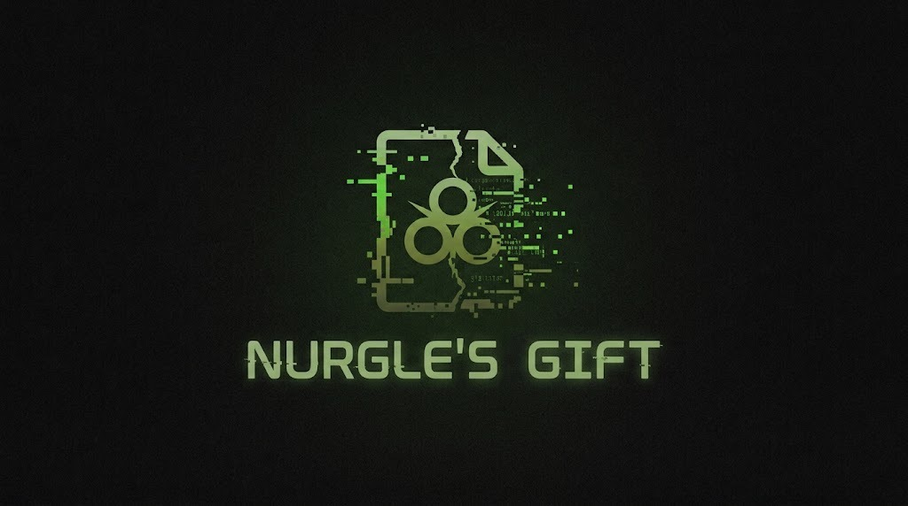

# Nurgle's gift



A file-corruption tool with a layered C++ architecture. It overwrites bytes in
target files with random noise at a configurable density, for testing software
resilience, fuzzing inputs, and studying how programs behave against malformed
or damaged data.

> ⚠️ **Destructive.** This tool writes random bytes directly into the files you
> point it at, in place. There is no undo. Only run it on copies or on data you
> can afford to lose.

## Architecture

The code is split into layers so the core logic stays free of OS and I/O
concerns and can be unit-tested on its own.

```
├── libs/
│   ├── engine/          # Layer 1: pure logic (no OS, no I/O)
│   │   ├── include/corruptor_engine.hpp
│   │   └── src/corruptor_engine.cpp
│   └── manager/         # Layer 2: OS interaction (file read/write, mmap)
│       ├── include/file_manager.hpp
│       └── src/file_manager.cpp
├── apps/
│   ├── cli/main.cpp     # Layer 3a: command-line front-end
│   └── daemon/          # Layer 3b: deadman-switch background process (WIP)
│       ├── main.cpp
│       └── monitor_logic.hpp
├── build/               # Build output (CMake)
├── tests/               # Unit tests for the engine (no OS dependencies)
├── CMakeLists.txt
└── Makefile
```

- **engine** — applies the noise to an in-memory buffer. Pure, deterministic
  given a seeded RNG; depends on nothing but the standard library.
- **manager** — opens files, reads them into a buffer (small files) or maps
  them with `mmap` (≥ 4 KiB), hands the buffer to the engine, and flushes.
- **cli** — parses arguments and walks files/directories.
- **daemon** — a deadman-switch process (still a stub; the `main.cpp` and
  `monitor_logic.hpp` are empty placeholders).

## Requirements

- A C++17 compiler.
- A **POSIX** system. `manager` uses `<sys/mman.h>`, `<fcntl.h>`, and
  `<unistd.h>`, so it builds and runs on Linux/macOS (or Windows via WSL),
  not on native Windows.

## Build

With CMake (out-of-source, into `build/`):

```sh
cmake -S . -B build -DCMAKE_BUILD_TYPE=Release
cmake --build build
```

This produces the `nurgle` executable in `build/`. The `engine` and `manager`
layers are built as static libraries and linked into it.

Or compile the CLI directly without CMake:

```sh
g++ -std=c++17 -O2 \
    -Ilibs/engine/include -Ilibs/manager/include \
    libs/engine/src/corruptor_engine.cpp \
    libs/manager/src/file_manager.cpp \
    apps/cli/main.cpp \
    -o nurgle
```

## Usage

```
./nurgle <path> [low|extreme|manual_density] [manual_mode]
```

- `<path>` — a file, or a directory (processed recursively).
- Profile (second argument):
  - `low` — density 0.1.
  - `extreme` — density 0.6, plus a scrambled header on files larger than 64 B.
  - a number — manual density ratio (0.0–1.0).
- `manual_mode` — optional integer mode, only used with a manual density
  (`1` also scrambles the first 64 bytes).

Examples:

```sh
./nurgle ./sample.bin low          # light corruption of one file
./nurgle ./sample.bin extreme      # heavy corruption + header scramble
./nurgle ./sample.bin 0.25 1       # 25% density, mode 1
./nurgle ./data_dir low            # recurse through a directory
```

## License

Licensed under the **GNU General Public License v3.0** (see [LICENSE](LICENSE)).

This is free software: you may use, study, modify, and redistribute it. The
copyleft terms require that **if you distribute the program or a modified
version, you make the complete corresponding source code available under the
same GPLv3 license.** In short: it is free, and your modifications must be
published when you share the software.
